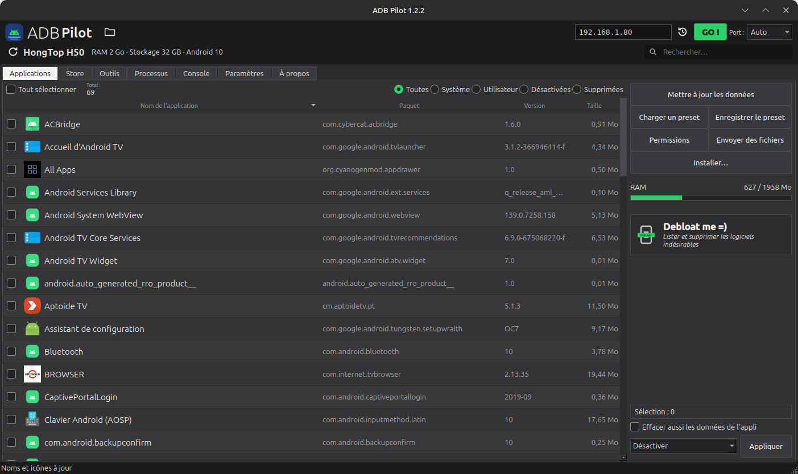
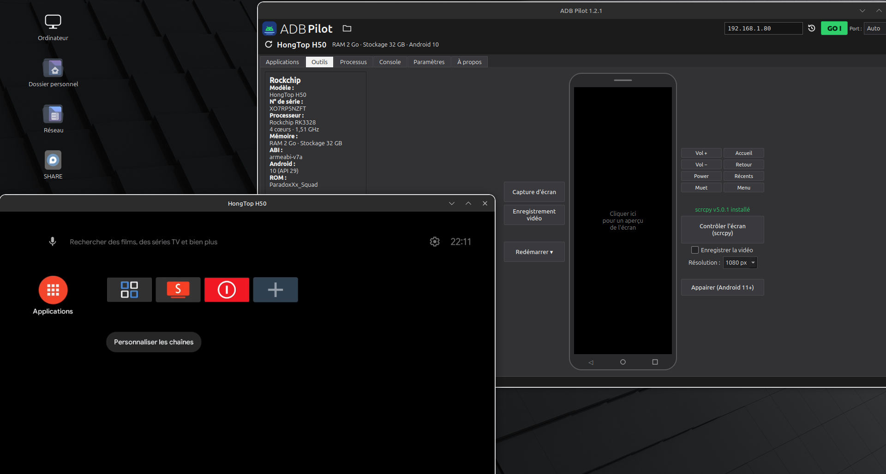
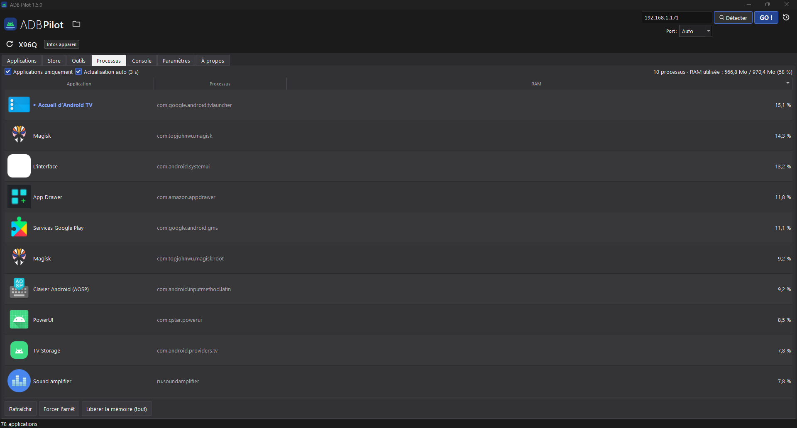
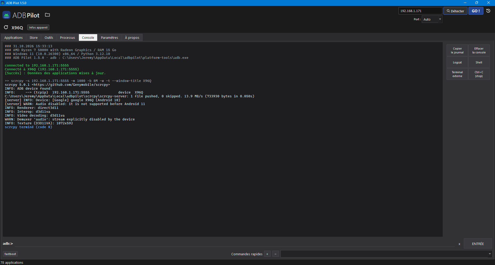
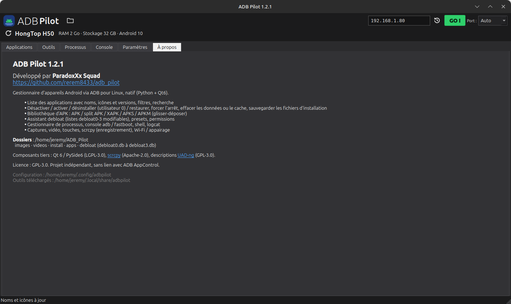

# ADB Pilot

**Gestionnaire d'appareils Android via ADB pour Linux et Windows, natif — sans Wine.**

ADB Pilot permet de gérer un téléphone ou une box Android TV depuis Ubuntu / Linux Mint ou Windows 10 / 11 : lister les applications avec leurs noms, icônes et versions, désactiver ou désinstaller le bloatware, installer des APK / XAPK / APKS / APKM, sauvegarder des applications, suivre les processus, piloter l'écran avec scrcpy et ouvrir une console adb / fastboot.

Développé par **ParadoxXx Squad** — [github.com/rerem8433/adb_pilot](https://github.com/rerem8433/adb_pilot)

🇫🇷 [Français](#adb-pilot) · 🇬🇧 [English](#adb-pilot--english)

> Interface disponible en **français** et en **anglais** (Paramètres → Interface → Langue).

<p align="center">
  <br>
  <em>Onglet Applications : noms réels, icônes et versions, actions groupées et assistant debloat</em>
</p>

---

## Pourquoi ce projet ?

J'utilisais depuis longtemps **[ADB AppControl](https://adbappcontrol.com)** (de *Cyber.Cat*) sous Windows pour gérer mes box Android TV. En passant sous Linux, la seule option était de le faire tourner via Wine, avec des résultats aléatoires.

ADB Pilot est donc une **réécriture complète pour Linux**, qui reprend l'ergonomie d'ADB AppControl. Aucun code, logo ou ressource d'ADB AppControl n'a été réutilisé : l'application est écrite de zéro en Python + Qt 6. Elle a été conçue avec l'aide de **Claude**, l'assistant IA d'Anthropic, puis testée et ajustée sur mon propre parc de box.

> ADB Pilot est un projet indépendant, **sans lien** avec ADB AppControl ni avec son auteur.

## Fonctionnalités

**Applications**
- Liste des applications avec **nom réel, icône et version**, sans rien installer sur l'appareil. Les infos sont lues directement dans les APK (manifeste, `resources.arsc`), alors qu'ADB AppControl passe par une appli compagnon.
- Filtres Toutes / Système / Utilisateur / Désactivées / Supprimées, recherche, tri par colonne.
- Actions groupées : désactiver, désinstaller (utilisateur 0), effacer les données, effacer le cache, sauvegarder le fichier d'installation. Au clic droit : activer, restaurer, forcer l'arrêt, permissions, infos détaillées.
- **Assistant debloat** à 4 niveaux (Basique, Sûr, Moyen, Maximal), avec **protection automatique des téléphones et tablettes**.
- Presets (listes d'applis cochées) à enregistrer et recharger.

**Installation**
- Bibliothèque d'APK favoris (`~/ADB_Pilot/install`) et dossier par appareil.
- APK, split APK, **XAPK** (avec OBB), **APKS**, **APKM**, par glisser-déposer.
- Pour chaque fichier, l'état sur l'appareil : non installée, identique, mise à jour disponible, version plus récente déjà installée.

**Outils**
- Infos de l'appareil : processeur (marque et modèle), RAM, stockage, et **vraie version d'Android**. Celle-ci est lue dans `framework-res.apk`, ce qui permet de repérer un `build.prop` falsifié.
- **Télécommande Android TV** à l'écran : pavé directionnel, accueil, retour, récents, volume, muet, capture d'écran, et bouton d'alimentation (éteindre, redémarrer, recovery, bootloader…).
- **scrcpy** intégré : choix de la résolution et enregistrement vidéo de la session (le son nécessite Android 11+).
- Connexion Wi-Fi (IP + port, historique avec le nom des boîtiers), passage USB → Wi-Fi, appairage Android 11+. Un seul appareil connecté à la fois.
- **Détection réseau** : bouton *Détecter* qui liste les appareils Android du réseau local avec leur nom (lu via ADB, mDNS Cast / Android TV / débogage sans fil, l'historique ou le réseau) et connexion en un clic.

**Store** : installation en un clic d'applications utiles (SmartTube, VLC, Projectivy Launcher…), rangées par rubriques. L'APK est téléchargé sur le PC puis installé sur le boîtier ; la liste est mise à jour automatiquement depuis ce dépôt.

**Processus** : applications en cours, RAM en %, application au premier plan, forcer l'arrêt.

**Console** : commandes `adb` / `fastboot`, shell interactif, logcat, commandes rapides. Taper `shell` ouvre un terminal.

## Captures d'écran

**Outils** : infos de l'appareil (processeur, RAM, stockage, vraie version d'Android) et scrcpy lancé à côté.



**Processus** : applications en cours, RAM en %, application au premier plan (▶ en vert).



**Console** : commandes adb / fastboot, shell, logcat, et la sortie de scrcpy.



**À propos** : version, crédits et dossiers utilisés.



## Compatibilité

Le paquet `.deb` est prévu pour les distributions **64 bits (amd64)** qui ont au minimum **glibc 2.34** et **Python 3.10**.

| Distribution | Statut |
|---|---|
| Ubuntu 22.04 LTS, 24.04 LTS et suivantes | ✅ Compatible |
| Linux Mint 21.x et 22.x (Cinnamon, MATE, Xfce) | ✅ Compatible (testé sous Linux Mint 22.3 Cinnamon) |
| Kubuntu, Xubuntu, Lubuntu, Ubuntu MATE 22.04+ | ✅ Compatible |
| Zorin OS 17+, Pop!_OS 22.04+, elementary OS 7+, KDE neon 22.04+ | ✅ Devrait fonctionner (base Ubuntu 22.04+) |
| Debian 12 (Bookworm) et suivantes | ⚠️ Devrait fonctionner (non testé) |
| Ubuntu 20.04, Linux Mint 20.x et plus anciennes | ❌ Non compatible (glibc et Python trop anciens) |
| Architectures ARM (Raspberry Pi…) | ❌ Non compatible (paquet amd64 uniquement) |

Fonctionne sous X11 et Wayland.

**Windows**

| Système | Statut |
|---|---|
| Windows 10 (1809+) et Windows 11, x64 | ✅ Compatible |
| Windows 11 ARM64 (Snapdragon X…) | ⚠️ Version ARM64 native **non testée sur un vrai appareil ARM** — merci de signaler tout problème. La version x64 fonctionne aussi en émulation. |

## Installation

### Linux

1. Télécharge le dernier `adbpilot_X.Y.Z_amd64.deb` dans les [Releases](https://github.com/rerem8433/adb_pilot/releases).
2. Installe-le **avec `apt`**, qui récupère automatiquement les dépendances :

```bash
sudo apt install ./adbpilot_X.Y.Z_amd64.deb
```

Le double-clic sur le fichier (Gestionnaire de paquets / GDebi) fonctionne aussi. Si tu utilises `dpkg -i`, lance ensuite `sudo apt -f install` pour compléter les dépendances.

ADB Pilot apparaît ensuite dans le menu des applications (catégorie Utilitaires), ou se lance avec la commande `adbpilot`.

### Windows

1. Télécharge dans les [Releases](https://github.com/rerem8433/adb_pilot/releases) :
   - `ADB-Pilot-X.Y.Z-windows-x64-setup.exe` pour un PC classique (Intel / AMD) ;
   - `ADB-Pilot-X.Y.Z-windows-arm64-setup.exe` pour un PC ARM (Snapdragon X…) — *non testée sur un vrai appareil ARM*.
2. Lance l'installateur. **adb, fastboot et scrcpy sont inclus**, rien d'autre à installer.
3. Les fichiers `.apk` ne sont **pas** associés automatiquement : une case (décochée par défaut) permet seulement d'ajouter ADB Pilot au menu *Ouvrir avec*.

Une version **portable** (`…-portable.zip`, sans installation) est aussi disponible.

> **USB sous Windows** : l'appareil n'apparaît que si un pilote ADB est installé (*Google USB Driver* ou celui du fabricant : Samsung, Xiaomi…). Un bouton **Paramètres → Pilote USB ADB** ouvre la page de Google. En **Wi-Fi**, aucun pilote n'est nécessaire.
>
> Windows SmartScreen peut afficher « Windows a protégé votre ordinateur » (installateur non signé) : *Informations complémentaires* → *Exécuter quand même*.

### Dépendances (Linux)

Rien à installer à la main. Tout est installé automatiquement par `apt` lors de l'installation du `.deb`.

**Obligatoires** (déjà présentes sur la plupart des bureaux Ubuntu/Mint) :

| Paquet | Rôle |
|---|---|
| `adb` | Communication avec les appareils Android |
| `scrcpy` | Affichage et contrôle de l'écran |
| `python3` (≥ 3.10) | Exécution de l'application |
| `libxcb-cursor0`, `libxcb-icccm4`, `libxcb-keysyms1`, `libxcb-image0`, `libxcb-render-util0`, `libxcb-shape0`, `libxcb-xkb1`, `libxcb-randr0`, `libxcb-util1`, `libxkbcommon0`, `libxkbcommon-x11-0` | Affichage Qt 6 sous X11 |
| `libwayland-client0`, `libwayland-cursor0`, `libwayland-egl1` | Affichage sous Wayland |
| `libegl1`, `libgl1`, `libfontconfig1`, `libfreetype6`, `libdbus-1-3`, `libglib2.0-0` | Rendu, polices, intégration au bureau |

**Recommandée** (installée par défaut avec `apt`) :

| Paquet | Rôle |
|---|---|
| `android-sdk-platform-tools-common` | Règles udev : accès aux appareils USB sans `sudo` |

**Suggérée** : `fastboot`, pour les commandes fastboot de la console.

Qt 6 / PySide6 est **embarqué dans le paquet**. Il n'y a rien à installer via `pip`.

> Une version plus récente d'adb ou de scrcpy que celle des dépôts peut être téléchargée depuis **Paramètres → Télécharger adb / scrcpy**.

### Désinstallation

```bash
sudo apt remove adbpilot
```

Sous Windows : *Paramètres → Applications → ADB Pilot → Désinstaller*.

Tes fichiers dans `~/ADB_Pilot` (Windows : `%USERPROFILE%\ADB_Pilot`) sont conservés.

## Premiers pas

- **USB** : active le *Débogage USB* dans les Options développeur de l'appareil, branche-le et accepte la demande d'autorisation. Si l'appareil apparaît en *no permissions*, vérifie que `android-sdk-platform-tools-common` est installé, puis débranche et rebranche.
- **Wi-Fi** : active le *Débogage ADB réseau* sur la box, saisis son IP en haut à droite (port `Auto` = 5555), puis **GO !** — ou clique sur **Détecter** pour la trouver automatiquement. Le bouton historique permet de se reconnecter en un clic.
- **Android 11+ sans fil** : Outils → *Appairer*.

## Compiler depuis les sources

```bash
python3 -m venv venv && . venv/bin/activate
pip install PySide6-Essentials
python -m adbpilot                                   # lancer sans installer
python packaging/build.py venv/lib/python3.*/site-packages out   # construire le .deb
```

**Windows** : les installateurs x64 et ARM64 sont construits automatiquement par GitHub Actions (`.github/workflows/windows.yml`) à chaque publication de release. En local, sous Windows : `pip install PySide6-Essentials==6.9.3 pyinstaller pillow certifi`, puis `python packaging/windows/build_windows.py` et Inno Setup avec `packaging/windows/adbpilot.iss`.

## Dossiers

Tout est centralisé dans `~/ADB_Pilot/` (Windows : `%USERPROFILE%\ADB_Pilot\`, sans espace, pratique en ligne de commande) :

| Dossier | Contenu |
|---|---|
| `~/ADB_Pilot/images/` | Captures d'écran |
| `~/ADB_Pilot/videos/` | Enregistrements d'écran et sessions scrcpy |
| `~/ADB_Pilot/install/` | Ta bibliothèque d'APK à installer (+ un sous-dossier par appareil) |
| `~/ADB_Pilot/apps/<appareil>/` | Sauvegardes : `nomappli_(paquet)_version.apk` (`.apks` pour les applis en plusieurs fichiers) |
| `~/ADB_Pilot/store/` | APK téléchargés depuis l'onglet Store (gardés pour tes autres boîtiers) |

La configuration est dans `~/.config/adbpilot/` et le cache des icônes dans `~/.cache/adbpilot/` (Windows : `%APPDATA%\adbpilot` et `%LOCALAPPDATA%\adbpilot`).

## Listes de debloat

Les listes `debloat0.db` à `debloat3.db` sont maintenues dans le dossier [`debloat/`](debloat/) de ce dépôt et mises à jour automatiquement au lancement d'ADB Pilot (une copie est intégrée à l'application pour fonctionner hors ligne). Rien n'est stocké ni modifiable côté utilisateur, ce qui évite d'appliquer par erreur une liste obsolète ou trop agressive.

**Protection des téléphones** : ADB Pilot détecte si l'appareil est une box TV. Sur un téléphone ou une tablette, les composants vitaux (contacts, téléphonie, SMS, horloge, clavier, Play Store, services Google…) ne sont jamais cochés par l'assistant, quel que soit le niveau, et une alerte s'affiche si tu essaies de les désactiver à la main.

Les niveaux sont **cumulatifs** :

| Niveau | Fichiers utilisés |
|---|---|
| Basique | `debloat0.db` |
| Sûr | `debloat0.db` + `debloat1.db` |
| Moyen | `debloat0.db` à `debloat2.db` |
| Maximal | `debloat0.db` à `debloat3.db` |

L'assistant ne fait que **cocher** les applications concernées. Rien n'est désactivé avant que tu cliques sur *Appliquer*.

## ⚠️ Avertissement

Désactiver ou désinstaller des applications système peut provoquer des dysfonctionnements : perte du clavier de la télécommande, de la mise à jour OTA, du Play Store… Vérifie toujours la liste avant d'appliquer. Une application supprimée pour l'utilisateur 0 peut être restaurée depuis le filtre *Supprimées* → clic droit → *Restaurer*. Tu utilises ce logiciel à tes propres risques.

## Mentions et crédits

- **Inspiration** : [ADB AppControl](https://adbappcontrol.com) par *Cyber.Cat*, pour l'ergonomie et le principe. Aucun code ni ressource repris. ADB AppControl est un logiciel propriétaire distinct.
- **Développement** : ParadoxXx Squad, avec l'aide de **Claude** (Anthropic).
- **Qt 6 / PySide6** — The Qt Company, licence **LGPL-3.0**. Embarqué dans le paquet et lié dynamiquement.
- **[Universal Android Debloater Next Generation (UAD-ng)](https://github.com/Universal-Debloater-Alliance/universal-android-debloater-next-generation)** — licence **GPL-3.0**. Descriptions de paquets affichées dans les infos-bulles.
- **[scrcpy](https://github.com/Genymobile/scrcpy)** — Genymobile, licence **Apache-2.0**. Non embarqué : installé depuis les dépôts ou téléchargé à la demande.
- **adb / fastboot** (Android SDK Platform-Tools) — Android Open Source Project, licence **Apache-2.0**. Non embarqués.
- **libxcb-cursor** — licence MIT/X11. Copie de secours incluse uniquement dans l'archive portable.
- *Android* est une marque de Google LLC. Les autres noms cités appartiennent à leurs propriétaires respectifs.

## Licence

ADB Pilot est distribué sous licence **GNU General Public License v3.0**. Voir le fichier [LICENSE](LICENSE).

Copyright © 2026 ParadoxXx Squad

---
---

# ADB Pilot — English

**Native Android device manager over ADB for Linux and Windows — no Wine needed.**

ADB Pilot lets you manage an Android phone or Android TV box from Ubuntu / Linux Mint or Windows 10 / 11. You can:
- list apps with their real names, icons and versions;
- disable or uninstall bloatware;
- install APK / XAPK / APKS / APKM files;
- back up apps;
- monitor running processes;
- mirror and control the screen with scrcpy;
- use an adb / fastboot console.

Developed by **ParadoxXx Squad** — [github.com/rerem8433/adb_pilot](https://github.com/rerem8433/adb_pilot)

> User interface available in **French** and **English** (Paramètres / Settings → Interface → Language).

<p align="center">
  <br>
  <em>Applications tab: real names, icons and versions, batch actions and debloat wizard</em>
</p>

## Why this project?

For a long time I used **[ADB AppControl](https://adbappcontrol.com)** (by *Cyber.Cat*) on Windows to manage my Android TV boxes. After moving to Linux, the only option left was running it through Wine, with hit-and-miss results.

ADB Pilot is a **complete rewrite for Linux** that follows the workflow of ADB AppControl. No code, logo or asset from ADB AppControl was reused: the app is written from scratch in Python + Qt 6. It was designed with the help of **Claude**, Anthropic's AI assistant, then tested and refined on my own fleet of boxes.

> ADB Pilot is an independent project, **not affiliated** with ADB AppControl or its author.

## Features

**Applications**
- App list with **real name, icon and version**, without installing anything on the device. Data is read directly from the APKs (manifest, `resources.arsc`). ADB AppControl relies on a companion app for this.
- Filters (All / System / User / Disabled / Uninstalled), search, sortable columns.
- Batch actions: disable, uninstall (user 0), clear data, clear cache, back up the installation file.
- Right-click actions: enable, restore, force stop, permissions, detailed info.
- 4-level **debloat wizard** (Basic, Safe, Medium, Maximum), with **automatic protection of phones and tablets**.
- Presets: save and reload sets of checked apps.

**Installation**
- Favourite APK library (`~/ADB_Pilot/install`), plus a folder per device.
- APK, split APK, **XAPK** (with OBB), **APKS**, **APKM**, with drag & drop.
- Each file shows its status on the device: not installed, identical, update available, or newer version already installed.

**Tools**
- Device info: CPU (brand and model), RAM, storage and the **real Android version**. The version is read from `framework-res.apk`, so a tampered `build.prop` is detected.
- On-screen **Android TV remote**: D-pad, home, back, recents, volume, mute, screenshot, and a power button (shut down, reboot, recovery, bootloader…).
- Built-in **scrcpy** launcher with resolution choice and session recording (audio requires Android 11+).
- Wi-Fi connection (IP + port, history with box names), USB → Wi-Fi switch, Android 11+ pairing. One device connected at a time.
- **Network detection**: a *Detect* button lists the Android devices on the local network with their name (read via ADB, mDNS Cast / Android TV / wireless debugging, history or the network) and connects in one click.

**Store**: one-click install of useful apps (SmartTube, VLC, Projectivy Launcher…), sorted by category. The APK is downloaded to the PC, then installed on the box; the list is updated automatically from this repository.

**Processes**: running apps, RAM usage in %, foreground app, force stop.

**Console**: `adb` / `fastboot` commands, interactive shell, logcat, quick commands. Typing `shell` opens a terminal.

## Screenshots

**Tools** (*Outils*): device info (CPU, RAM, storage, real Android version), with scrcpy running alongside.


**Processes** (*Processus*): running apps, RAM usage in %, foreground app (green ▶).


**Console**: adb / fastboot commands, shell, logcat and scrcpy output.


**About** (*À propos*): version, credits and folders used.


## Compatibility

The `.deb` package targets **64-bit (amd64)** distributions with at least **glibc 2.34** and **Python 3.10**.

| Distribution | Status |
|---|---|
| Ubuntu 22.04 LTS, 24.04 LTS and newer | ✅ Compatible |
| Linux Mint 21.x and 22.x (Cinnamon, MATE, Xfce) | ✅ Compatible (tested on Linux Mint 22.3 Cinnamon) |
| Kubuntu, Xubuntu, Lubuntu, Ubuntu MATE 22.04+ | ✅ Compatible |
| Zorin OS 17+, Pop!_OS 22.04+, elementary OS 7+, KDE neon 22.04+ | ✅ Should work (Ubuntu 22.04+ base) |
| Debian 12 (Bookworm) and newer | ⚠️ Should work (untested) |
| Ubuntu 20.04, Linux Mint 20.x and older | ❌ Not compatible (glibc and Python too old) |
| ARM architectures (Raspberry Pi…) | ❌ Not compatible (amd64 package only) |

Works on both X11 and Wayland.

**Windows**

| System | Status |
|---|---|
| Windows 10 (1809+) and Windows 11, x64 | ✅ Compatible |
| Windows 11 ARM64 (Snapdragon X…) | ⚠️ Native ARM64 build **not tested on real ARM hardware** — please report any issue. The x64 build also runs under emulation. |

## Installation

### Linux

1. Download the latest `adbpilot_X.Y.Z_amd64.deb` from the [Releases](https://github.com/rerem8433/adb_pilot/releases) page.
2. Install it **with `apt`**, which pulls in the dependencies automatically:

```bash
sudo apt install ./adbpilot_X.Y.Z_amd64.deb
```

Double-clicking the file (Package Installer / GDebi) also works. If you use `dpkg -i`, run `sudo apt -f install` afterwards to complete the dependencies.

ADB Pilot then appears in the application menu (Utilities), or can be started with the `adbpilot` command.

### Windows

1. Download from the [Releases](https://github.com/rerem8433/adb_pilot/releases) page:
   - `ADB-Pilot-X.Y.Z-windows-x64-setup.exe` for a regular PC (Intel / AMD);
   - `ADB-Pilot-X.Y.Z-windows-arm64-setup.exe` for an ARM PC (Snapdragon X…) — *not tested on real ARM hardware*.
2. Run the installer. **adb, fastboot and scrcpy are included**, nothing else to install.
3. `.apk` files are **not** associated automatically: an option (unchecked by default) only adds ADB Pilot to the *Open with* menu.

A **portable** build (`…-portable.zip`, no installation) is also available.

> **USB on Windows**: the device only shows up once an ADB driver is installed (*Google USB Driver* or the manufacturer's: Samsung, Xiaomi…). **Settings → ADB USB driver** opens Google's page. Over **Wi-Fi**, no driver is needed.
>
> Windows SmartScreen may say "Windows protected your PC" (unsigned installer): *More info* → *Run anyway*.

### Dependencies (Linux)

Nothing to install by hand. Everything is installed automatically by `apt` when installing the `.deb`.

**Required** (already present on most Ubuntu/Mint desktops):

| Package | Purpose |
|---|---|
| `adb` | Communication with Android devices |
| `scrcpy` | Screen mirroring and control |
| `python3` (≥ 3.10) | Runs the application |
| `libxcb-cursor0`, `libxcb-icccm4`, `libxcb-keysyms1`, `libxcb-image0`, `libxcb-render-util0`, `libxcb-shape0`, `libxcb-xkb1`, `libxcb-randr0`, `libxcb-util1`, `libxkbcommon0`, `libxkbcommon-x11-0` | Qt 6 display on X11 |
| `libwayland-client0`, `libwayland-cursor0`, `libwayland-egl1` | Display on Wayland |
| `libegl1`, `libgl1`, `libfontconfig1`, `libfreetype6`, `libdbus-1-3`, `libglib2.0-0` | Rendering, fonts, desktop integration |

**Recommended** (installed by default with `apt`):

| Package | Purpose |
|---|---|
| `android-sdk-platform-tools-common` | udev rules: USB device access without `sudo` |

**Suggested**: `fastboot`, for fastboot commands in the console.

Qt 6 / PySide6 is **bundled in the package**. Nothing needs to be installed with `pip`.

> A newer adb or scrcpy than the one in the repositories can be downloaded from **Paramètres → Télécharger adb / scrcpy** (Settings → Download).

### Uninstall

```bash
sudo apt remove adbpilot
```

On Windows: *Settings → Apps → ADB Pilot → Uninstall*.

Your files in `~/ADB_Pilot` (Windows: `%USERPROFILE%\ADB_Pilot`) are kept.

## Getting started

- **USB**: enable *USB debugging* in the device's Developer options, plug it in and accept the authorization prompt. If the device shows up as *no permissions*, make sure `android-sdk-platform-tools-common` is installed, then unplug and replug it.
- **Wi-Fi**: enable *ADB over network* on the box, type its IP in the top-right field (port `Auto` = 5555), then click **GO !** — or click **Detect** to find it automatically. The history button reconnects in one click.
- **Android 11+ wireless debugging**: Outils (Tools) → *Appairer* (Pair).

## Build from source

```bash
python3 -m venv venv && . venv/bin/activate
pip install PySide6-Essentials
python -m adbpilot                                   # run without installing
python packaging/build.py venv/lib/python3.*/site-packages out   # build the .deb
```

**Windows**: the x64 and ARM64 installers are built automatically by GitHub Actions (`.github/workflows/windows.yml`) whenever a release is published. Locally, on Windows: `pip install PySide6-Essentials==6.9.3 pyinstaller pillow certifi`, then `python packaging/windows/build_windows.py` and Inno Setup with `packaging/windows/adbpilot.iss`.

## Folders

Everything lives in `~/ADB_Pilot/` (Windows: `%USERPROFILE%\ADB_Pilot\`; no spaces, easy to use from a terminal):

| Folder | Content |
|---|---|
| `~/ADB_Pilot/images/` | Screenshots |
| `~/ADB_Pilot/videos/` | Screen recordings and scrcpy sessions |
| `~/ADB_Pilot/install/` | Your APK library (+ one sub-folder per device) |
| `~/ADB_Pilot/apps/<device>/` | Backups: `appname_(package)_version.apk` (`.apks` for split apps) |
| `~/ADB_Pilot/store/` | APKs downloaded from the Store tab (kept for your other boxes) |

Settings are stored in `~/.config/adbpilot/` and the icon cache in `~/.cache/adbpilot/` (Windows: `%APPDATA%\adbpilot` and `%LOCALAPPDATA%\adbpilot`).

## Debloat lists

The `debloat0.db` to `debloat3.db` lists are maintained in this repository's [`debloat/`](debloat/) folder and updated automatically when ADB Pilot starts (a copy is bundled for offline use). Nothing is stored or editable on the user side, so an outdated or overly aggressive list can't be applied by mistake.

**Phone protection**: ADB Pilot detects whether the device is a TV box. On a phone or tablet, vital components (contacts, telephony, SMS, clock, keyboard, Play Store, Google services…) are never checked by the wizard, whatever the level, and a warning is shown if you try to disable them manually.

Levels are **cumulative**:

| Level | Files used |
|---|---|
| Basic | `debloat0.db` |
| Safe | `debloat0.db` + `debloat1.db` |
| Medium | `debloat0.db` to `debloat2.db` |
| Maximum | `debloat0.db` to `debloat3.db` |

The wizard only **checks** the matching apps. Nothing is disabled until you click *Appliquer* (Apply).

## ⚠️ Disclaimer

Disabling or uninstalling system apps can break things: remote-control keyboard, OTA updates, Play Store… Always review the list before applying. An app uninstalled for user 0 can be restored from the *Supprimées* (Uninstalled) filter → right-click → *Restaurer* (Restore). Use this software at your own risk.

## Credits and notices

- **Inspiration**: [ADB AppControl](https://adbappcontrol.com) by *Cyber.Cat*, for its workflow and concept. No code or assets reused. ADB AppControl is a separate proprietary program.
- **Development**: ParadoxXx Squad, with the help of **Claude** (Anthropic).
- **Qt 6 / PySide6** — The Qt Company, **LGPL-3.0** license. Bundled and dynamically linked.
- **[Universal Android Debloater Next Generation (UAD-ng)](https://github.com/Universal-Debloater-Alliance/universal-android-debloater-next-generation)** — **GPL-3.0** license. Package descriptions shown in tooltips.
- **[scrcpy](https://github.com/Genymobile/scrcpy)** — Genymobile, **Apache-2.0** license. Not bundled: installed from the repositories or downloaded on demand.
- **adb / fastboot** (Android SDK Platform-Tools) — Android Open Source Project, **Apache-2.0** license. Not bundled.
- **libxcb-cursor** — MIT/X11 license. Fallback copy included only in the portable archive.
- *Android* is a trademark of Google LLC. Other names mentioned belong to their respective owners.

## License

ADB Pilot is released under the **GNU General Public License v3.0**. See [LICENSE](LICENSE).

Copyright © 2026 ParadoxXx Squad
